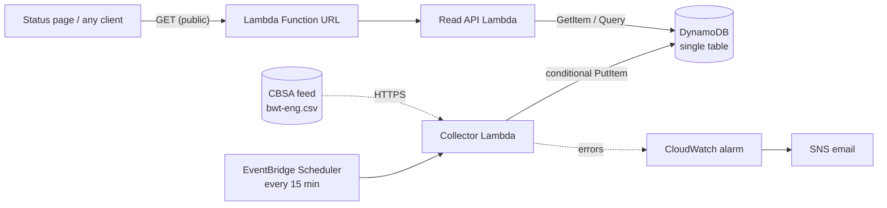

# 🛂 Border Wait Live

[](https://github.com/Yash8418/border-wait-live/actions/workflows/ci.yml)

A serverless AWS pipeline that records live wait times at Canada–US land border crossings every 15 minutes and serves them through a public API.

**[Live status page →](https://yash8418.github.io/border-wait-live/)** · **Live API:** [`/crossings`](https://usxkgejvlxpu7g5qnoasanrtjm0stxqu.lambda-url.us-east-2.on.aws/crossings) · deployed in `us-east-2`, collecting every 15 minutes since November 11, 2026.

## Why

The Canada Border Services Agency (CBSA) publishes **current** wait times, but its public **historical** data stopped being published at hourly detail after 2019 — recent years are only available as monthly summaries. This project collects the live feed continuously so hour-by-hour history exists again, starting with the Windsor–Detroit crossings. It picks up where the historical analysis in **[border-wait-analysis](https://github.com/Yash8418/border-wait-analysis)** ends.

## Architecture



| Piece | Choice | Why |
|---|---|---|
| Schedule | EventBridge Scheduler, `rate(15 minutes)` | CBSA updates roughly hourly; 15 minutes catches each update without wasted runs. Can be paused with a stack parameter. |
| Collector | Lambda, Python 3.12, arm64, 128 MB | Standard library only (plus boto3 from the runtime) — no build step or layers. |
| Storage | DynamoDB on-demand, single table | Two access patterns, both key lookups; pay per request with no idle cost. Table is retained if the stack is deleted. |
| API | Lambda Function URL, CORS `GET` only | Free, unlike API Gateway, and enough for a read-only JSON API. |
| Permissions | One role per function | The collector can only `PutItem`; the API can only `GetItem` and `Query`. |
| Monitoring | CloudWatch alarm → SNS email | Emails when the collector errors in 3 consecutive runs. Logs kept 14 days. |
| Infrastructure | AWS SAM ([`template.yaml`](template.yaml)) | Everything is code, linted with cfn-lint in CI. |

## Table design

One table, two kinds of items, keyed by `pk` (partition) and `sk` (sort):

| Item | `pk` | `sk` | Used by |
|---|---|---|---|
| History reading | `CROSSING#ambassador-bridge` | `2026-11-11T06:15:00Z` (when CBSA observed it, UTC) | `GET /crossings/{id}/history` — a `Query` with `sk BETWEEN from AND to` |
| Latest reading | `LATEST` | `ambassador-bridge` | `GET /crossings` (one `Query` on `pk = LATEST`) and `GET /crossings/{id}` (`GetItem`) |

Both carry the same attributes: office, location, the four flows (`travellers_canada_status` / `_min`, `commercial_canada_…`, `travellers_us_…`, `commercial_us_…`), the local timestamp as published, and `collected_at`.

**Idempotent writes.** CBSA republishes the same reading until it updates, so the collector runs 4 times for each new value. A history item is written with `attribute_not_exists(pk)`, so repeats are rejected by DynamoDB instead of creating duplicates, and the latest item is only replaced by a *newer* `observed_at` — a late or retried run can never overwrite fresher data.

**Why not one partition per day?** About 700 new readings a day across all crossings is far below a single partition's limits, and keeping a crossing's history in one partition makes any date range a single `Query`.

## API

| Route | Returns |
|---|---|
| `GET /crossings` | The latest reading at every crossing |
| `GET /crossings/{id}` | The latest reading at one crossing (404 if unknown) |
| `GET /crossings/{id}/history?from=&to=&limit=` | Readings in a time range (ISO 8601; default last 24 hours, up to 31 days and 2,000 readings) |

```bash
curl https://usxkgejvlxpu7g5qnoasanrtjm0stxqu.lambda-url.us-east-2.on.aws/crossings/ambassador-bridge/history
```

## Cost

Estimated monthly usage in `us-east-2`:

| Service | Usage | Cost |
|---|---|---|
| Lambda | ~2,900 collector runs (< 1 s at 128 MB) + API requests | Within the always-free 1M requests / 400,000 GB-s |
| DynamoDB writes | ~125,000 write units (29 conditional puts per run; rejected repeats still count) | ≈ $0.08 |
| DynamoDB storage | ~10 MB added per month | Within the always-free 25 GB |
| EventBridge Scheduler | ~2,900 invocations | Within the 14M free invocations |
| CloudWatch Logs, SNS | A few MB of logs (14-day retention), an alarm, rare emails | Free tier |

**Total: under $0.10 a month.** Ways it could cost more, and what limits them: heavy API traffic (Function URL; set `ApiConcurrencyLimit` once the account's concurrency quota allows it) and log growth (retention is capped at 14 days).

## Tech stack

- **AWS Lambda** (Python 3.12) for collection and the read API
- **Amazon DynamoDB** for time-series storage
- **Amazon EventBridge Scheduler** for the 15-minute schedule
- **AWS SAM** for infrastructure as code
- **GitHub Actions** for linting (ruff), tests (pytest + moto) and template validation (cfn-lint)

## Data source

[Current Border Wait Times](https://open.canada.ca/data/en/dataset/d4a716f5-a2fc-4c3c-88ed-451fe05900e4) — CBSA, Open Government Licence – Canada.

## Status page

[`site/`](site/) is a static page that reads the API: current waits at the three Windsor–Detroit crossings with a 24-hour trend, plus a filterable table of every port of entry. It refreshes every minute and flags readings more than 3 hours old.

It reads the live API set in [`site/config.js`](site/config.js) (`window.BORDER_WAIT_API`). Open the page with `?api=<ApiUrl>` to use another deployment, or `?api=sample` to show a sample built from a captured copy of the feed (`python scripts/build_sample.py`).

```bash
python -m http.server -d site 8000   # http://localhost:8000
```

## Deploying

See [docs/aws-setup.md](docs/aws-setup.md): deploy from AWS CloudShell with one `sam deploy`, or let GitHub Actions deploy after CI passes using short-lived OIDC credentials (no stored keys).
